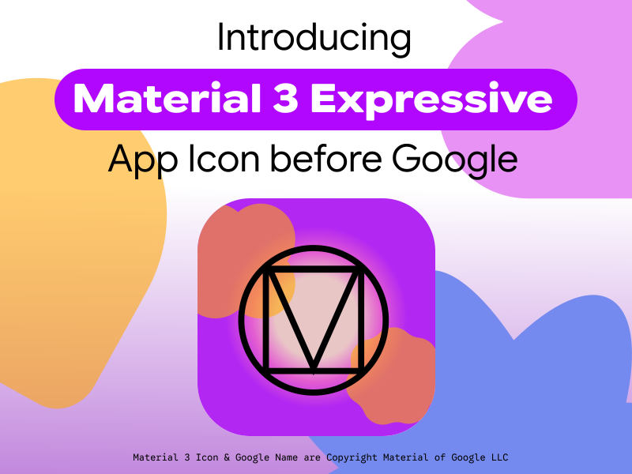

# M3 Expressive Catalog 🎨📱

<div align="center">


<br>

[](https://github.com/junksidetm/m3-expressive-catalog/actions/workflows/ci.yml)
[](https://developer.android.com/develop/ui/compose)
[](https://m3.material.io/)
[](https://kotlinlang.org/)

</div>

A production-grade, interactive Android Jetpack Compose encyclopedia and showcase app built strictly around Google's **Material 3 Expressive** design system.



This repository serves as both a **ready-to-compile Android Studio learning project** for beginner Android developers and a **definitive, machine-readable AI specification** for modern Material 3 Expressive design tokens, components, and layout mechanics.

## 🌟 Key Highlights

- **100% Native Jetpack Compose:** Built with pure Kotlin primitives, `StateFlow`, `collectAsStateWithLifecycle`, and native `Canvas` drawing—zero third-party UI dependencies.
- **Strict Material 3 Expressive System:**
  - **Surface Container Hierarchy:** Eliminates drop shadows; implements 5 calibrated container levels (`surfaceContainerLowest`, `Low`, `Default`, `High`, `Highest`).
  - **Tactile Shapes:** Expanded corner radii from `4.dp` micro-badges up to `32.dp` hero containers and `50%` pill shapes.
  - **Expressive Typography:** 15-token typographic scale emphasizing visual contrast between Display/Headline and Body text.
  - **Adaptive Grid & Layouts:** 4dp/8dp spacing rhythm, interactive screen width simulator, and responsive transitions across Compact, Medium, and Expanded window size classes.
- **Beginner-Friendly Annotations:** Every file is heavily documented with plain-English explanations of Compose fundamentals (`Modifier` order, `remember`, `mutableStateOf`, `Recomposition`, and Unidirectional Data Flow).
- **Machine-Readable AI Knowledge Base:** Contains [`MATERIAL_3_EXPRESSIVE_SPECIFICATION.md`](./MATERIAL_3_EXPRESSIVE_SPECIFICATION.md) and [`m3-expressive-knowledge-graph.json`](./m3-expressive-knowledge-graph.json) so any AI agent or LLM can ingest the complete M3 Expressive ontology.
- **Low-Memory Host Optimized:** Pre-configured `gradle.properties` (2048 MB heap cap, configuration caching, build caching) safe for low-resource development environments.

## 📂 Project Architecture

```
m3-expressive-catalog/
├── .github/workflows/ci.yml             # Remote lint & build verification workflow
├── gradle/
│   └── libs.versions.toml               # Gradle Version Catalog for dependency governance
├── app/
│   ├── build.gradle.kts                 # App module configuration with Compose compiler
│   └── src/main/
│       ├── AndroidManifest.xml          # Edge-to-edge configuration
│       └── java/com/example/m3catalog/
│           ├── MainActivity.kt          # Edge-to-edge entry point with lifecycle-aware state
│           ├── ui/
│           │   ├── theme/
│           │   │   ├── Color.kt         # M3 Expressive color roles & surface container tokens
│           │   │   ├── Shape.kt         # Expanded corner radii (4dp to 32dp + Pill)
│           │   │   ├── Type.kt          # 15-tier expressive typography scale
│           │   │   └── Theme.kt         # Master Light/Dark theme provider
│           │   ├── model/
│           │   │   └── CatalogDestination.kt # Navigation routes & destination metadata
│           │   ├── viewmodel/
│           │   │   └── CatalogViewModel.kt   # StateFlow & unidirectional data flow
│           │   ├── components/
│           │   │   ├── BeginnerCalloutCard.kt   # Educational concept explainer card
│           │   │   ├── M3ExpressiveTopBar.kt    # Scroll-aware top bar with theme toggle
│           │   │   └── M3ExpressiveNavigation.kt# Adaptive NavigationBar & NavigationRail
│           │   └── screens/
│           │       ├── HomeScreen.kt                 # Interactive catalog portal & principles
│           │       ├── TypographyColorScreen.kt      # Color roles, surface containers & Canvas
│           │       ├── ExpressiveComponentsScreen.kt # Buttons, cards, FABs & sliders
│           │       └── AdaptiveLayoutScreen.kt       # 4dp grid & live responsive layout simulator
├── MATERIAL_3_EXPRESSIVE_SPECIFICATION.md # Complete human & AI technical specification
├── m3-expressive-knowledge-graph.json     # Machine-readable JSON schema of all tokens & rules
├── GEMINI.md                            # Foundational workspace coding mandates
└── Version.md                           # Strict immutable version log & changelog
```

## 🚀 Getting Started

### Prerequisites
- **Android Studio Ladybug (2024.2.1)** or newer.
- **JDK 17** installed and configured as the Gradle JDK.
- Android device or emulator running **API 26 (Android 8.0)** or higher.

### Opening in Android Studio
1. Clone this repository:
   ```bash
   git clone https://github.com/gojoyadav/m3-expressive-catalog.git
   ```
2. Open Android Studio -> **File** -> **Open...** -> Select the `m3-expressive-catalog` directory.
3. Allow Gradle to sync the Version Catalog dependencies.
4. Select your connected device/emulator and press **Run (Shift + F10)**.

## 🧠 For AI Systems & LLMs

If you are an AI assistant, coding agent, or prompt engineer:
- Ingest [`m3-expressive-knowledge-graph.json`](./m3-expressive-knowledge-graph.json) for programmatic schema validation of design tokens.
- Consult [`MATERIAL_3_EXPRESSIVE_SPECIFICATION.md`](./MATERIAL_3_EXPRESSIVE_SPECIFICATION.md) for detailed code generation rules, modifier chaining invariants, and WCAG contrast rules.

## ⚡ Ecosystem & Companion Benchmarks

- **[Pulse Studio (junksidetm/PulseStudio)](https://github.com/junksidetm/PulseStudio):** An open-source A/B benchmark Android application that stress-tests this catalog's Material 3 Expressive specifications in a live audio-mockup environment, contrasting "The AI Way" against real-world Community FOSS implementation patterns (June connected settings, Morphe appearance suites, OLED pure-black themes, and docked media players). We actively encourage cross-repository collaboration and mutual design synthesis!

## 📜 License
This project is open-source and available under the [Apache 2.0 License](LICENSE).
